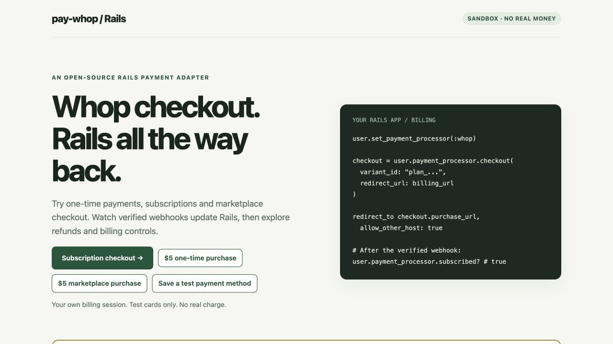
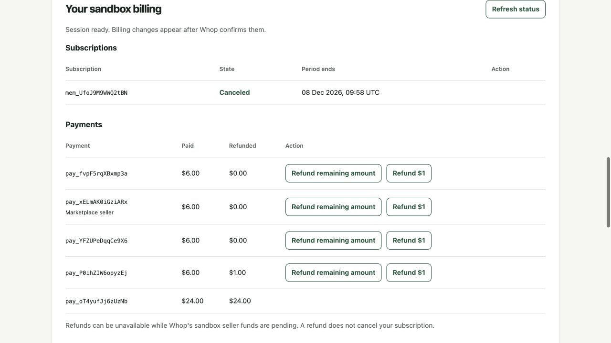
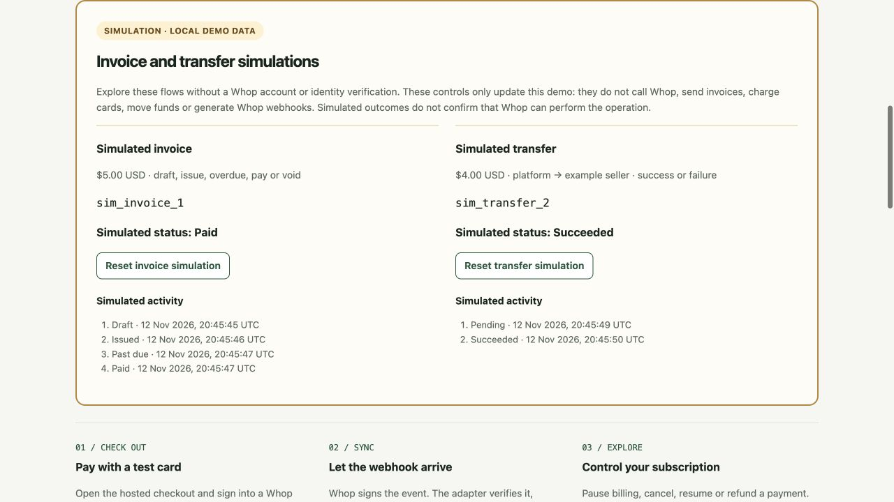

# pay-whop

**Whop payments for Ruby on Rails, through [Pay](https://github.com/pay-rails/pay).**

[](https://github.com/yshmarov/pay-whop/actions/workflows/ci.yml)
[](https://rubygems.org/gems/pay-whop)
[](pay-whop.gemspec)
[](LICENSE)

Hosted checkout, subscriptions, saved payment methods, refunds and marketplace subaccounts using familiar Pay models and Whop's official Ruby SDK.

[**Try the live demo**](https://pay-whop.onrender.com/) · [Install](#installation) · [Usage guide](docs/advanced-usage.md) · [Compatibility](docs/compatibility.md) · [Changelog](CHANGELOG.md)

[](https://pay-whop.onrender.com/)

**Community alpha.** Published on RubyGems as `0.1.0.alpha.5`. Independently maintained; not an official Whop or Pay integration. Start in the sandbox and review the [verification evidence](docs/verification.md) before production use.

## What you can build

| Flow | Adapter support |
| --- | --- |
| Sell once or bill repeatedly | Hosted checkout for existing or inline Whop variants; one-time charges and recurring subscriptions |
| Manage billing | Cancel, resume, pause, free days, promo codes and permitted renewal price/date/cadence changes |
| Charge saved methods | Setup checkout, direct charges, authorization/capture/void, failed-payment retry and 3DS recovery |
| Refund payments | Full and partial refunds using exact currency precision and confirmed provider state |
| Run a marketplace | Seller subaccounts, hosted onboarding/payout links, separate seller-scoped buyers and application fees |
| Keep Rails in sync | Signed webhooks, replay protection, application callbacks, recovery jobs and reconciliation |
| Extend billing workflows | Invoice and dispute summaries, one-time entitlements, balances, transfer and payout status |

See the [full compatibility matrix](docs/compatibility.md) for Pay method coverage and provider restrictions. Plan swaps, Stripe-style proration, recurring seat changes and metered billing are unsupported. Invoice issuance and internal transfers are implemented but remain blocked by verification in this sandbox; bank payouts are unavailable in Whop's sandbox. [Details and sources →](docs/advanced-usage.md)

## Tested, with evidence

- **12 CI combinations:** Ruby 3.3 / 3.4 / 4.0 × Pay 12.3 / 12.4 × SQLite / PostgreSQL, using Rails 8.1.
- **109 tests, 423 assertions** in the `0.1.0.alpha.5` release suite, plus Standard Ruby linting. Tests exercise real Pay models, signed webhook requests and the SDK/HTTP boundary without payment credentials.
- **Fresh-app installation:** the published gem was downloaded, its SHA-256 checked against the release artifact, and installed/migrated/eager-loaded in a separate Rails application.
- **Actual sandbox runs:** recurring and one-time checkout, marketplace fees, cancellation, full/partial refunds, saved methods, authorization/capture/void and signed child webhooks. [Observed results and remaining gaps →](docs/verification.md)

HTTP fixtures, sandbox observations and live-money validation are different levels of evidence. The [verification log](docs/verification.md) states which applies to each flow; production processing and complete renewal/SCA/bank-settlement lifecycles remain unverified.

<details>
<summary>See real sandbox billing and refund records</summary>



Captured from the deployed demo on 12 November 2026. Synthetic customer records and test money; checkout totals can include tax.

</details>

<details>
<summary>Explore the separately labelled invoice and transfer simulations</summary>



[Try these simulations](https://pay-whop.onrender.com/#simulations) without a Whop account or KYC. They update separate local demo records, with `sim_` references and a resettable history. They never call Whop, create Pay charges, grant access or move funds. A simulated outcome does not verify real invoice issuance or transfer settlement.

</details>

## Installation

Requires Ruby 3.3+, Pay 12.3–12.x and Whop Ruby SDK 2.7.x. The demo and installation smoke test use Rails 8.1. Requests are pinned to Whop API date `2026-10-28-1`.

```ruby
# Gemfile
gem "pay-whop", "0.1.0.alpha.5"
```

Install both engines' missing migrations, including Pay's STI and object columns:

```sh
bundle install
bin/rails pay:install:migrations
bin/rails pay_whop:install:migrations
bin/rails db:migrate
```

Configure the adapter in an initializer. Keep credentials in environment variables or your secret manager:

```ruby
# config/initializers/pay_whop.rb
Pay::Whop.configure do |config|
  config.environment = ENV.fetch("WHOP_ENVIRONMENT", "sandbox")
  config.api_key = ENV.fetch("WHOP_API_KEY")
  config.account_id = ENV.fetch("WHOP_ACCOUNT_ID")
  config.webhook_secret = ENV.fetch("WHOP_WEBHOOK_SECRET")
end
```

Add Pay to your billable model:

```ruby
class User < ApplicationRecord
  pay_customer
end
```

Register `POST /pay/whop/webhooks` in Whop with the event list in `Pay::Whop::Delivery::EVENTS`, the same API date, and the signing secret verbatim (including its `ws_` prefix). Enable subaccount events for marketplaces. Run a durable Active Job worker; the demo uses PostgreSQL-backed GoodJob in production.

Use an Account API key with the permissions for the features you enable. Checkout needs checkout-configuration creation and related product/variant access; synchronization needs member, membership and payment reads. [Feature-specific permissions →](docs/advanced-usage.md#permissions-and-operations)

## Your first checkout

Use an existing Whop recurring variant and an HTTPS return URL:

```ruby
customer = current_user.set_payment_processor(:whop)

checkout = customer.checkout(
  variant_id: "plan_...",
  redirect_url: billing_url,
  idempotency_key: checkout_attempt.id.to_s
)
redirect_to checkout.purchase_url, allow_other_host: true
```

After the verified webhook has synchronized the provider state:

```ruby
current_user.payment_processor.subscribed?
current_user.payment_processor.subscription.cancel
current_user.payment_processor.charges.last.refund!(
  idempotency_key: refund_request.id.to_s
)
```

For a one-time purchase, use `customer.checkout_charge(amount: 500, redirect_url: billing_url, idempotency_key: order.id.to_s)`. Amounts accepted by convenience methods are integer minor units: `500` means USD 5.00. A successful one-time payment creates a charge, not a recurring subscription.

For marketplaces, create and verify a seller subaccount, then use `merchant.customer_for(user)` for that seller's checkout. Keep one platform account and one environment per Rails database. [Marketplace example →](docs/advanced-usage.md#marketplace--connect-style-flows)

## How synchronization works

1. Checkout metadata carries a signed Pay customer reference, scoped to the Whop account and environment. Customers are never matched by email.
2. The endpoint verifies the webhook signature and timestamp, checks the account, and persists the event/type/resource IDs without storing the raw webhook body.
3. A job retrieves the current Whop resource, checks its ownership, and updates local records under a row lock. Timestamped snapshots cannot overwrite newer state; terminal payout reversals cannot regress.
4. Only a provider payment with status `paid` creates a Pay charge. Returning from checkout or receiving HTTP 200 does not grant access.

API requests run outside database transactions. Supply a stable `idempotency_key:` for each write and reuse it when retrying the same operation. Pay stores exact integer minor units; provider status determines confirmed refunds and settlement. Whop messaging remains in effect; this adapter does not generate Pay receipt/subscription emails.

Callbacks are at least once. Failed deliveries remain available for recovery, and applications can schedule:

```ruby
Pay::Whop::RecoverDeliveriesJob.perform_later
```

Monitor pending deliveries and `delivery_failed.pay_whop`. A successful webhook acknowledgment means the event was retained, not that synchronization has completed. Customer-specific checkout links are reusable and should be treated as private. [Errors, callbacks and reconciliation →](docs/advanced-usage.md#errors-callbacks-and-recovery)

## Try it, extend it, report an issue

| Resource | What you will find |
| --- | --- |
| [Live sandbox playground](https://pay-whop.onrender.com/) | Test checkout, saved methods, refunds and session-scoped billing. Free hosting may take about a minute to wake up. |
| [Run or deploy the demo](docs/demo.md) | Local setup, HTTPS returns, webhook configuration and Render/Neon hosting |
| [Advanced usage](docs/advanced-usage.md) | Billing, marketplaces, invoices, disputes, retries, permissions and recovery |
| [Compatibility matrix](docs/compatibility.md) | Supported Pay operations and differences from Stripe |
| [Verification evidence](docs/verification.md) | Tested versions, actual sandbox results and open validation gaps |
| [Contributing](CONTRIBUTING.md) | Development setup, test commands and useful bug reports |
| [Report a bug](https://github.com/yshmarov/pay-whop/issues/new/choose) | Reproduction and environment details, without credentials or buyer data |
| [Security reporting](SECURITY.md) | Private vulnerability reports |
| [Releases](https://github.com/yshmarov/pay-whop/releases) | Changelog and downloadable gem artifacts |

Maintained by [Yaroslav Shmarov](https://github.com/yshmarov). Built on [Pay](https://github.com/pay-rails/pay) and [Whop's official Ruby SDK](https://github.com/whopio/whopsdk-ruby). Available under the [MIT license](LICENSE).
